# Roomover

Turning move-out season into move-in opportunities.

Roomover is a campus marketplace that passes furniture and dorm essentials from students who move out at the end of a term to the students who move in next, even when the two never share a day on campus. AI agents built on Anthropic's Claude models furnish the arriving student's room in 3D and negotiate with each seller's agent, and PayPal holds the student's one payment through a photo check at handoff before PayPal Payouts pays every seller.

<picture>
  <source media="(prefers-color-scheme: dark)" srcset="docs/stack-dark.png">
  
</picture>

## Links

| What | Where |
| --- | --- |
| Hosted demo | https://roomover.onrender.com |
| Demo video (YouTube, 2:44) | https://youtu.be/lww3KxAN5gc |
| Fastest path for judges | [Four steps](#fastest-path-for-judges) |
| Test accounts for judges | [Test accounts](#test-accounts-for-judges) |
| Proof on the PayPal sandbox | [Real sandbox IDs](#real-sandbox-ids) |
| Model Context Protocol (MCP) server for AI assistants | `https://roomover.onrender.com/mcp` |

<a href="https://youtu.be/lww3KxAN5gc"></a>

## The problem

Every spring, students who move out leave behind furniture and dorm essentials that still work. Universities that run collection drives weigh what they catch, and the numbers are large even at one campus.

| Figure | What the source measured | Source |
| --- | --- | --- |
| 16.2 tons | Reusable goods the University of Michigan (U-M) collected in donations during the spring 2026 student move out, among them 4.7 tons of bedding and 4.4 tons of household items | [U-M News, May 2026](https://news.umich.edu/?p=223096) |
| 44 tons | Material the Michigan State University (MSU) Surplus Store and Recycling Center collected for resale during the spring 2024 move out | [Bridge Michigan, May 30, 2024](https://bridgemi.com/michigan-environment-watch/trash-treasure-rethinking-waste-michigan-college-towns/) |
| 250 tons | Material MSU's crew picked up from residence halls during that same move out week, reported as 500,000 pounds | [Bridge Michigan, May 30, 2024](https://bridgemi.com/michigan-environment-watch/trash-treasure-rethinking-waste-michigan-college-towns/) |

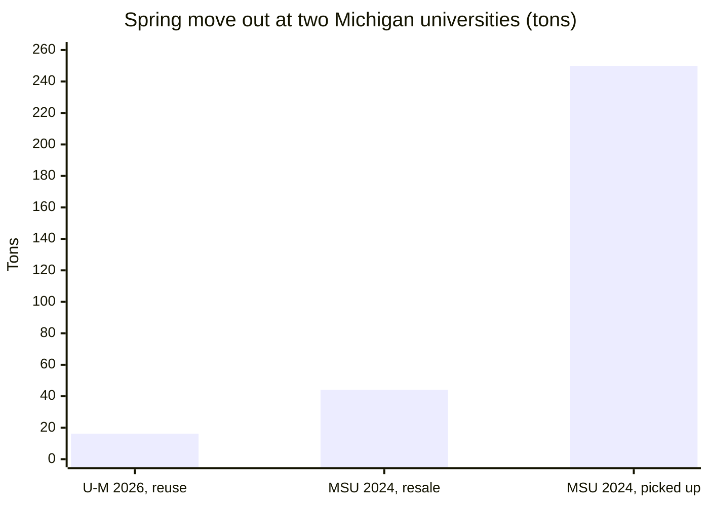

Campus resale apps already exist, and they all depend on the buyer and the seller meeting in person to swap the item and the money. The student who leaves in May and the student who arrives in late summer are never on campus at the same time, so most of this supply never reaches its next owner. Roomover bridges that gap with PayPal. The arriving student pays once when the room is planned, PayPal holds the money across the gap, and each seller gets paid after the item passes a photo check at handoff.

### How Roomover differs

| Category | Examples | What they leave out |
| --- | --- | --- |
| Dorm planners and room visualizers | DesignYourDorm, Roomie, Elevate My Dorm | They sell new products only, so the furniture students leave behind never enters the plan |
| Campus resale apps | DormShare, DormDeal, Quadsale | Buyer and seller meet and pay in person, so a sale from one term to the next falls through |
| Roomover | | Plans the room in 3D from used items, and PayPal holds the payment through the handoff, the photo check, and the payout |

## How it works

Roomover runs three flows at the fictional Lakeshore University, whose rooms follow the sizes of real residence hall rooms. Ava, Jun, Marcus, Sofia, and Lea are leaving and list 24 items between them. Jordan is arriving at Harbor Hall 214 with a $150 budget.

The Furnish and Handoff images follow one live run of "$150, cozy, I study late" on the hosted demo. The buyer agent negotiated 6 items from 4 students for $107, and Lea's bean bag showed a new tear at handoff. The video follows another live run of the same request, 7 items from 4 students for $116, since the buyer agent plans each run afresh. The sandbox proof below also cites the handoff demo plan. A script builds this fixed cart from all five sellers for the handoff tests, and its real sandbox run charged $144 and paid out $139 after one torn chair. A judge's own handoff pays every seller in the cart the agent built.

### 1. Sell: a leaving student lists an item from one photo

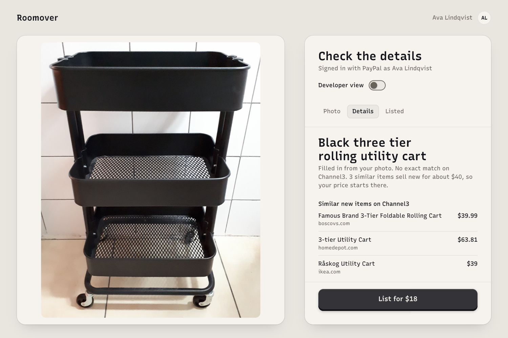

Ava logs in with PayPal, which gives Roomover the email her payouts go to. She takes one photo, and the product search application programming interface (API) from Channel3 finds matching retail products with their new prices, and with their sizes when the retailer lists them. The seller agent picks the match and writes the listing. When no product is the same one, the agent picks the similar ones, and code prices the listing from their median new price. The sample cart has no exact match, so three similar carts set its new price at about $40, and the size fields fill from a similar item for Ava to check. Code caps the price at 70 percent of the new price, and Ava sets the lowest price her agent may accept.

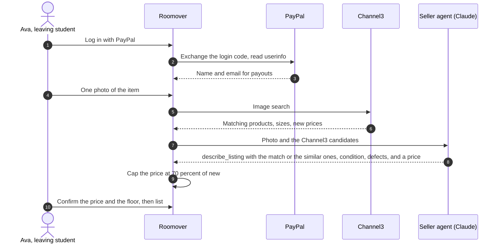

### 2. Furnish: the room fills itself, and one PayPal approval covers the whole cart

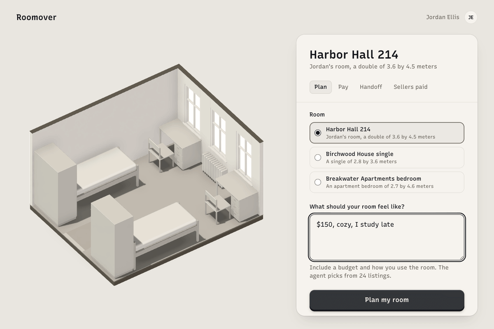

Jordan types "$150, cozy, I study late". The buyer agent reads the room size and the hall rules, searches the listings, and places each item while code checks the fit, the rules, and the budget. Every placed item lands in the 3D room as it goes, streamed to the browser over server sent events (SSE). The agent then offers each seller's agent a price and a handoff slot, the seller agents answer in parallel, and code holds every answer between the seller's floor and the asking price. When no used item fits a need, Channel3 supplies a new product that fits the size and the budget. The Harbor Hall plan ends at $107, and Channel3's cheapest comparable new items would cost $260.97 more. The GIF and the image below show that run on the hosted demo, where PayPal's own JavaScript software development kit (SDK) v6 renders the buttons.

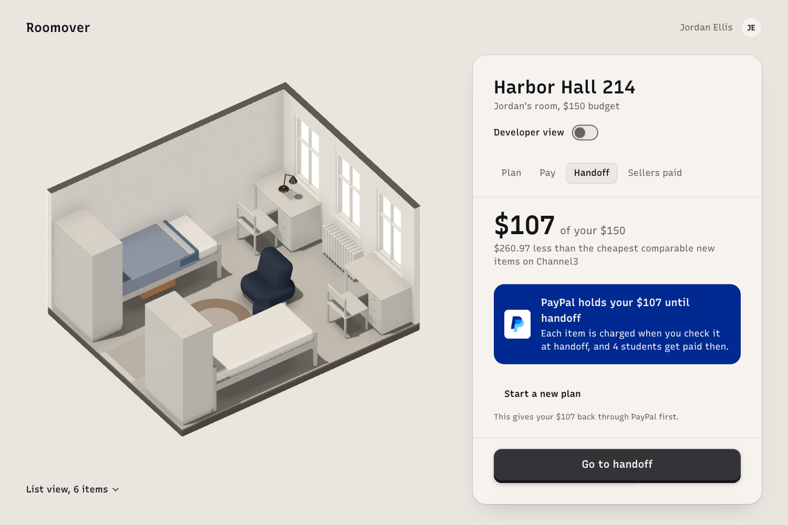

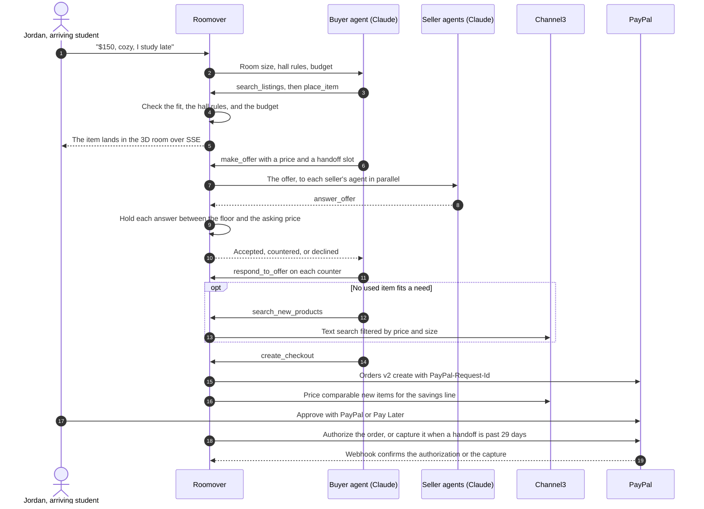

### 3. Handoff: a photo check per item, then PayPal pays every seller

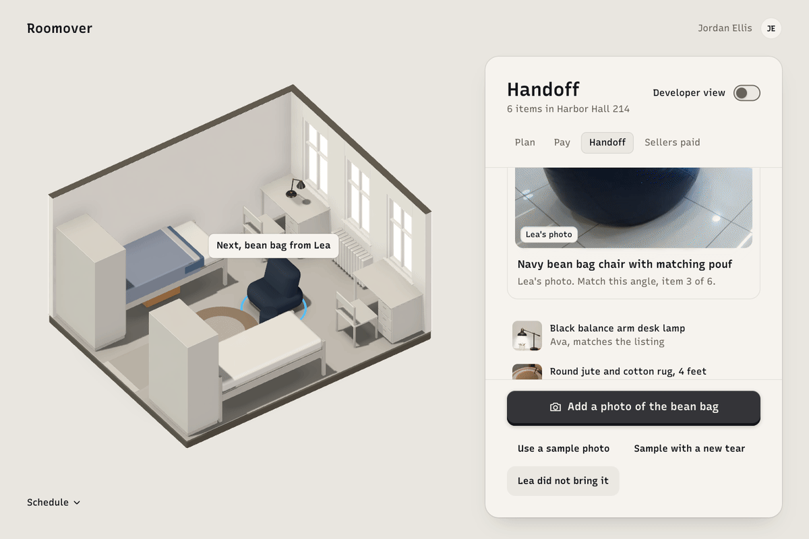

At handoff, Jordan photographs each item. The verifier agent compares the photo with the listing photos, and the money policy in code turns its finding into an amount. In the run above, Lea's bean bag shows a new 15 cm tear. The money policy treats that as major damage and offers the bean bag at half of the agreed $27, so Jordan keeps it for $13.50. In the handoff demo plan, a new 3 cm tear in Marcus's mesh desk chair counts as minor damage, and Jordan pays $30 of the $35. After the last item, settlement captures each kept item from the authorization and sends one PayPal Payouts batch with an item for each seller in the cart. The run above captured $93.50 of the $107 and paid its four sellers this way, and the demo plan's run paid $139 to its five sellers. A dispute the buyer opens later in PayPal comes back to the verifier agent, and Roomover answers with one message in the inquiry stage and with evidence after escalation.

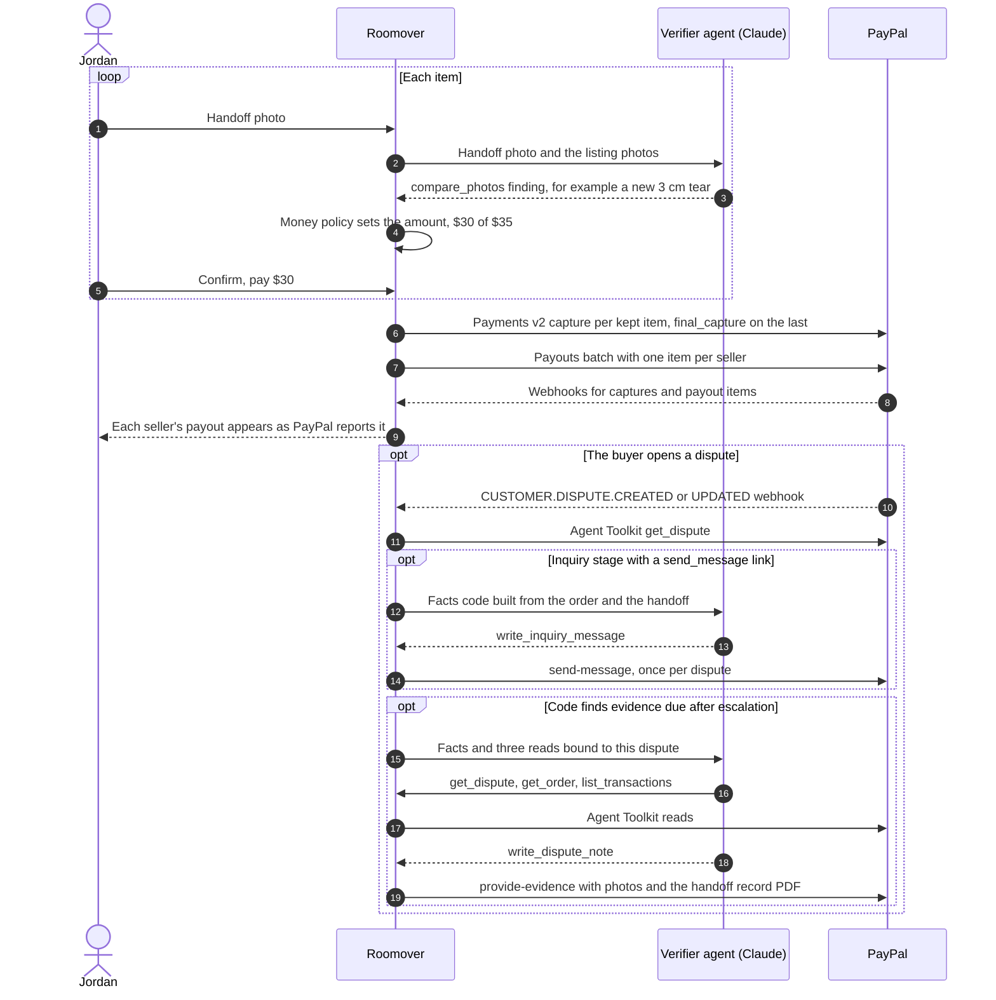

The [schedule](#bryntum) on the Handoff screen shows each seller's move out window, Jordan's move in, and the handoff slot each pair of agents agreed on, and a student can drag a slot to another time both windows allow.

## PayPal integration

PayPal runs the money path from the seller's login through the dispute after handoff. Roomover's server code calls the PayPal Server SDK for TypeScript, PayPal's REST APIs, and the PayPal Agent Toolkit, and the browser renders the PayPal JavaScript SDK v6 buttons. Code computes every amount. Every money moving write (order create, authorize, capture, void, reauthorize, refund, and payout) sends a `PayPal-Request-Id` built from Roomover's own record IDs, such as `rmv.capture.<order item>.<attempt>`.

| Capability | PayPal product | Where Roomover uses it | Files | Proof from the sandbox |
| --- | --- | --- | --- | --- |
| Seller onboarding | Log in with PayPal | Identity and the email payouts go to | `lib/paypal/rest/identity.ts`, `lib/sell/login.ts`, `app/api/auth/paypal/` | Seller 1 signs in on the hosted Sell screen |
| Checkout | Orders v2 and JavaScript SDK v6 buttons | One approval for a cart from several sellers, authorized or captured on approval | `lib/paypal/server-sdk/orders.ts`, `lib/checkout/prepare.ts`, `lib/checkout/approve.ts`, `components/paypal/paypal-checkout.tsx` | Order `4BJ62082TS2591355` for $144 (handoff demo plan) |
| Pay in installments | Pay Later (Pay in 4) | The Pay Later button and message at checkout | `components/paypal/paypal-checkout.tsx`, `components/paypal/sdk-v6.ts` | The $107 cart shows 4 payments of $26.75 |
| Hold and settle | Orders v2 authorize or capture at approval, then Payments v2 capture, partial capture, void, reauthorize, and refund | Per item settlement after the photo check | `lib/paypal/server-sdk/payments.ts`, `lib/handoff/settle.ts`, `lib/domain/settlement.ts`, `lib/handoff/release.ts` | Authorization `87S91919A36663839` with five captures for $139. In capture mode, capture `4LF69479JL425463Y` and refund `3Y551341LC337200B` |
| Seller payouts | Payouts (batch) | One batch per settlement | `lib/paypal/rest/payouts.ts`, `lib/handoff/payouts.ts`, `lib/domain/payout-state.ts` | Batch `D65SGN757KMKA`, $139 to 5 sellers |
| Disputes | Disputes API | The inquiry message and the evidence the verifier assembles | `lib/paypal/rest/disputes.ts`, `lib/disputes/run.ts`, `lib/disputes/evidence.ts` | Dispute `PP-R-ACE-10197629`, resolved in the seller's favor |
| Events | Webhooks with signature verification | Drive the state machines and the activity panel | `app/api/paypal/webhooks/route.ts`, `lib/paypal/rest/webhooks.ts`, `lib/paypal/webhooks/dispatch.ts` | Events `WH-3L121548ED733810T-55R95869ET117181H` and `WH-60G77830PR553712K-7TE52535X23651306` |
| Agent tools | PayPal Agent Toolkit (TypeScript) | Read only lookups inside the verifier's dispute run | `lib/agents/tools/paypal-read.ts`, `lib/disputes/deps.ts` | `get_dispute`, `get_order`, and `list_transactions` on the dispute above |
| Reporting | Transaction Search through the Agent Toolkit's `list_transactions` | The verifier reads the disputed transaction in its dispute run | `lib/agents/tools/paypal-read.ts`, `lib/disputes/deps.ts` | Seller transaction `8YE464155G502411H` |

In settlement and the hourly release, PayPal's answer decides whether a retry reuses the key.

| PayPal's answer to a keyed write | What Roomover does next |
| --- | --- |
| No answer, a 5xx, or a 429 | Sends the same key once more right away and keeps it for the next try, so PayPal replays its first answer if the write landed |
| A 408, a 409, or a 2xx body Roomover cannot read | Keeps the key for the next try |
| A 400, 401, 403, 404, or 422, or a capture that comes back `DECLINED` or `FAILED` | Moves the record to its next attempt, so the next try sends a new key |

A declined approval cancels the order, so the student's next checkout starts a new order with keys of its own. The two dispute calls, `provide-evidence` and `send-message`, take no key, so a conditional update on the dispute row lets each one go out once.

### Payment mode

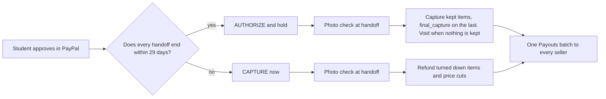

An authorization lasts 29 days, so Roomover uses `AUTHORIZE` when every handoff in the order ends within 29 days of checkout and `CAPTURE` otherwise. A storage handoff months away captures at checkout and refunds any item the student turns down. Settlement reauthorizes at most once, and only from day 4 of an authorization, after PayPal's 3 day honor period. Reauthorization is implemented and unit tested, and no sandbox run has reached day 4, so no reauthorization ID exists. For US buyers, PayPal's [Pay Later overview](https://developer.paypal.com/pay-later/overview) lists Pay in 4 for purchases from $10 to $2,000 and Pay Monthly from $49 to $10,000.

### Real sandbox IDs

Every ID below came from a real sandbox response.

| Run | IDs |
| --- | --- |
| Live run on the hosted demo, shown in the Furnish and Handoff images | Order `5KS30897JA235312N` for $107, authorization `3X8053579U008480N`, $93.50 captured after the torn bean bag, payout batch `HBQNY6FAD2E3W` to 4 sellers |
| The demo video's run on the hosted demo | Order `6MU60631JD595151V` for $116, authorization `0JB37270PK541901W`, $102 captured after the torn bean bag, payout batch `K2TTK5JBAL2SG` to 4 sellers |
| Handoff demo plan on Render, settled by webhook | Order `4BJ62082TS2591355`, authorization `87S91919A36663839`, payout batch `D65SGN757KMKA` for $139 |
| Handoff demo plan run locally, with the torn chair at $30 of $35 | Order `78E19905K1239093D`, authorization `49F41736WL517390H`, payout batch `SMBUWTGSLQG9J` |
| Capture mode, a storage cart with April 2027 handoff slots and one item turned down | Order `4NJ97274JR406582M` for $73, capture `4LF69479JL425463Y`, refund `3Y551341LC337200B` of $10 for Ava's drawer tower, payout batch `8XRP3TRPXKKGG` of $63 to Ava and Marcus |
| Real dispute on the chair | `PP-R-ACE-10197629`, evidence of 3 documents in the chargeback stage, resolved `RESOLVED_SELLER_FAVOUR` |
| The Claude app over MCP | Plan `ef094b22-8462-45b8-8806-2c8f05b8b1f5`, $95 for 5 used items from 4 students, order `2V83399493834153N` |
| Claude Code over MCP, approved from the preview link | Order `5YK1548532769840E`, authorization `66J9960711469954E` |
| Webhook proof on Render | Payout batch `VPTHNHH95DHHA`, events `WH-3L121548ED733810T-55R95869ET117181H` and `WH-9M890275JE3662201-846994697J906225K` |
| What the sandbox refused | A multi payee `AUTHORIZE` order (422 `UNSUPPORTED_INTENT`, debug ID `f7166095860d0`), a Venmo payout (debug ID `f271928c32152`) |

## AI

### Model

Every agent runs on `claude-sonnet-5-5` through the Claude Messages API with tool use and vision for photos. The buyer agent plans at medium effort. The two photo calls also run at medium effort, the seller agent's `describe_listing` on Sell and the verifier's `compare_photos` at handoff. The short writing calls run at low effort, the seller agent's offer answers and the verifier's dispute note and inquiry message. Prompt caching covers the buyer agent's system prompt, its hall rules, and the conversation so far, and the instructions of the three writing calls. Each photo call sends one request per photo, so it sets no cache breakpoint.

### Agents and tools

| Agent | Acts for | Tools | What code checks |
| --- | --- | --- | --- |
| Buyer agent | The arriving student | `search_listings`, `get_room_preset`, `get_hall_rules`, `check_fit`, `place_item`, `remove_item`, `make_offer`, `respond_to_offer`, `search_new_products`, `place_new_product`, `create_checkout` | Budget, hall rules, fit in the room including the 915 mm path from each bed to the door, and every offer against the seller's floor |
| Seller agent | The leaving student | `describe_listing` with Channel3's candidates, `answer_offer` in negotiation | The price cap at 70 percent of new, and every answer held between the floor and the asking price. An answer that would sell under the floor becomes a counter at the asking price |
| Verifier agent | Neither student | `compare_photos`, `write_dispute_note`, `write_inquiry_message`, and the Agent Toolkit's `get_dispute`, `get_order`, `list_transactions` | The money policy turns a finding into an amount. The note and the message may name only amounts code gave, and the message may not offer a refund or accept a claim |

Negotiation runs through structured offers with a price, a handoff slot, and up to four listings from one seller in a bundle, for at most 3 rounds. The seller agents answer in parallel, and every offer and answer appears in the activity panel.

### Guardrails

- Code computes every amount. The model proposes, and deterministic code sets capture, refund, and payout amounts from the verifier's structured result, with 15 percent off, rounded to the dollar, for minor new damage.
- No money moves without the student's approval in PayPal. Agents and the MCP server prepare orders, and only the student approves them.
- Code parses every model output with the zod schema library for TypeScript, and an invalid answer gets one retry with the validation error. After a second invalid answer, the buyer agent, the Sell photo read, and the handoff photo check each show a failure the student can retry. An offer answer becomes a decline that code writes, and the dispute note and the inquiry message fall back to text that code writes.
- The verifier cannot accept a dispute claim, offer a refund, or move money. Code checks its dispute note for any amount code did not give, and its inquiry message for those amounts and for any offer, refund, or accepted claim.
- A seller's floor stays between the seller and code. No search result, activity line, MCP answer, or page shows it, and code puts a seller agent sentence that hints at it in its own words.
- The demo caps its own use at 6 runs per browser and 15 per network an hour, and 400 Claude calls a day. Sell gives each photo at most 2 seller agent calls and each browser 20 photos a day. Every limit keys on the client address that Render's Cloudflare proxy writes.

### PayPal Agent Toolkit, read only

The verifier's dispute run reads the dispute, the PayPal order, and the disputed transaction through three tools from the PayPal Agent Toolkit. Code binds each tool to the dispute's own IDs and allows no other tool, so the agent reads facts and every write stays in Roomover's own code.

### MCP server for outside assistants

The MCP server at `https://roomover.onrender.com/mcp` speaks streamable HTTP, so a general assistant can shop on a student's behalf.

| MCP tool | What it does |
| --- | --- |
| `search_listings` | Finds used items by campus, category, words, price, and size, and names any hall rule an item breaks |
| `get_room_presets` | Lists room sizes, provided furniture, and hall rules |
| `plan_room` | Runs the buyer agent with its negotiation and returns the items, the PayPal total, and a 3D preview link, with progress while it runs |
| `create_checkout` | Returns PayPal's approval link for the plan. The student approves in PayPal |

| Limit | Value |
| --- | --- |
| `plan_room` per MCP session | 3 in a rolling hour |
| `plan_room` across all MCP sessions | 10 in a rolling hour |
| Claude calls MCP may spend | 150 of the demo's 400 a day |
| Open sessions | 300. A full table closes the session idle longest, and a session idle for 30 minutes closes |

In the video, the Claude app plans Harbor Hall 214 through these tools. The plan holds 5 used items from 3 students for $87, and its link opens the preview page with PayPal's own buttons.

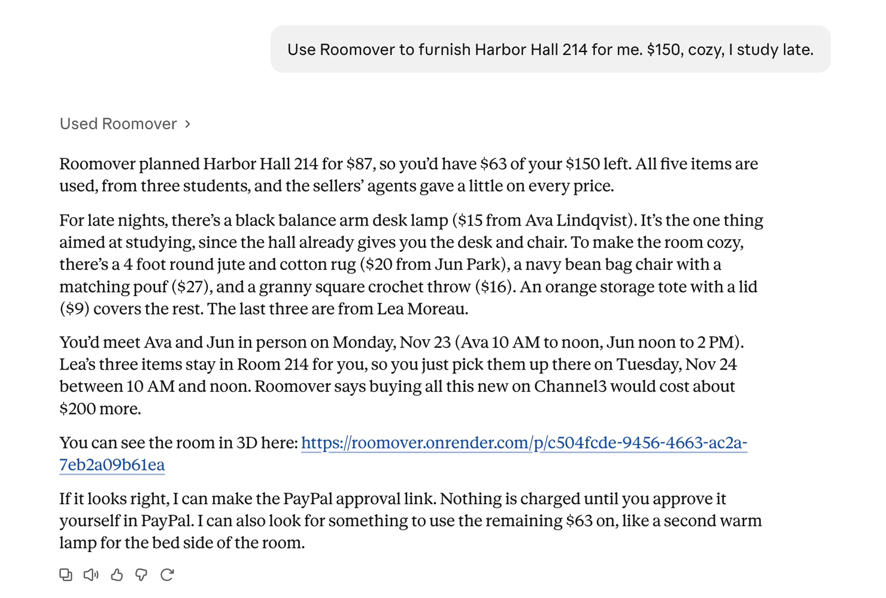

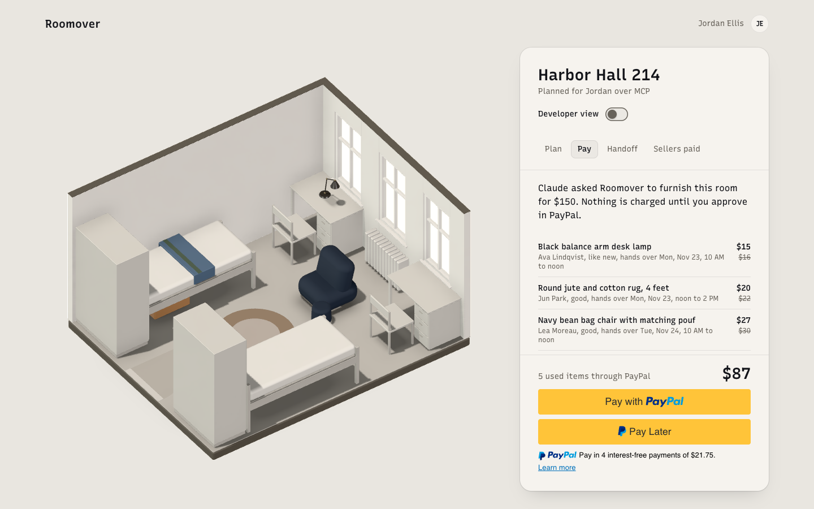

The first browser that approves the payment from a preview link takes the plan over for the handoff, and other browsers see the plan read only. The activity panel names the client from the `clientInfo` it sends. A session that arrives from Anthropic's published outbound addresses is the Claude app, since its connector reports the same `claude-code` name as Claude Code.

#### Connect an assistant

1. **Claude app** (web or desktop, Pro or Max). Open Customize, then Connectors, then Add, then Add custom connector. Name it Roomover, paste `https://roomover.onrender.com/mcp`, choose no sign in, and press Add. In a new chat, turn Roomover on in the tools menu and send this request. "I am Jordan, moving into Harbor Hall 214 at Lakeshore University. Use Roomover to plan my room for "$150, cozy, I study late" and give me the PayPal link to approve it."
2. **Claude Code**. Run `claude mcp add --transport http roomover https://roomover.onrender.com/mcp`, then send the same request.
3. **MCP Inspector**. Run `npx @modelcontextprotocol/inspector`, choose the Streamable HTTP transport, and enter the same URL.

Open the approval link the assistant returns, sign in as the judge buyer from [Test accounts](#test-accounts-for-judges), and approve. PayPal returns to the preview page, which shows the held payment with the order and authorization IDs in the Developer view.

## Sponsor tools

### Channel3

Channel3 powers search in two of the three flows, Sell and Furnish. For a seller's photo it finds the matching product when there is one and similar products otherwise, and Roomover uses Channel3's products for the new price reference, the size, and the savings line.

| Where | What Channel3 does | Files |
| --- | --- | --- |
| Sell | Image search finds the product in the seller's photo, or similar products when none is the same one. The match, or the median of the similar ones, gives the new price reference and the size | `lib/channel3/identify.ts`, `lib/sell/analyze.ts` |
| Furnish | Text search fills a gap with a new product filtered by price and size, when no used listing fits | `lib/channel3/products.ts`, `lib/agents/buyer/new-products.ts` |
| Savings | The cheapest comparable new product prices each used item, so the plan shows what the student saved | `lib/domain/savings.ts` |

Searches are cached by photo and by query, so a repeated demo run spends no credits. New items count against the budget, stay out of the PayPal order, and link out to the retailer.

### Render

Render is the cloud platform that runs the hosted demo, and the blueprint in `render.yaml` declares every service below. Each secret's value lives only in the Render dashboard, and a push to `main` deploys.

| Piece | What it runs |
| --- | --- |
| Web service `roomover` | The Next.js app, the agents, and the MCP server, Starter plan in Ohio, health check at `/api/health` that reports the deployed commit |
| Postgres `roomover-db` | Every record, reached over the private network |
| Pre-deploy command | `npm run db:migrate` applies new migrations before each deploy goes live |
| Cron job `roomover-release` | Hourly. Voids or refunds demo holds that never reached a handoff, carries on settlements that stopped, and puts listings back on sale |
| Cron job `roomover-reseed` | Daily. Moves the demo listing windows to the current campus day |

### Bryntum

Bryntum makes JavaScript scheduling components, and its Scheduler draws the handoff schedule with each seller's move out window, the storage wait, Jordan's move in, and the agreed slots as keys a student can drag or move from the keyboard. The schedule reads its rows from the handoff view that Next.js serves, and each slot move posts to the handoff's slots route, where the server checks it against both windows and the authorization before it moves the handoff. Roomover runs the 45 day trial the hackathon offers participants, and the scheduler loads only when the schedule opens (`components/schedule/`).

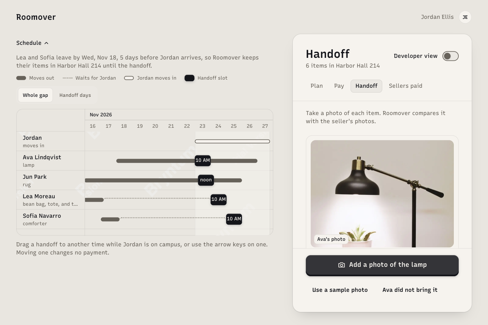

## Development

The PayPal integration was built with the APIMatic Context Plugin for PayPal connected to an AI coding agent. APIMatic generates the PayPal Server SDK for TypeScript, its plugin documents that SDK for coding agents, and the agent queried the plugin before each piece of PayPal code. Where the SDK has no coverage, PayPal's published OpenAPI specs and a sandbox probe filled the gap.

| PayPal integration | Client | Files |
| --- | --- | --- |
| Orders v2 | PayPal Server SDK 2.5.0 | `lib/paypal/server-sdk/orders.ts`, `lib/checkout/` |
| Payments v2 | PayPal Server SDK 2.5.0 | `lib/paypal/server-sdk/payments.ts`, `lib/handoff/settle.ts` |
| Transaction Search | PayPal Agent Toolkit `list_transactions` in the verifier's dispute run. A Server SDK search wrapper has unit tests and no flow calls it | `lib/agents/tools/paypal-read.ts`, `lib/paypal/server-sdk/transactions.ts` |
| App token | Roomover's REST code, which the Server SDK reads through its token provider | `lib/paypal/rest/app-token.ts`, `lib/paypal/server-sdk/client.ts` |
| Payouts | REST | `lib/paypal/rest/payouts.ts` |
| Disputes | REST | `lib/paypal/rest/disputes.ts` |
| Webhooks | REST | `lib/paypal/rest/webhooks.ts`, `lib/paypal/webhooks/` |
| Log in with PayPal | REST | `lib/paypal/rest/identity.ts` |
| Read only agent tools | PayPal Agent Toolkit 1.11.0 | `lib/agents/tools/paypal-read.ts` |
| Buttons and Pay Later | JavaScript SDK v6 | `components/paypal/` |

The table below lists five lookups where the plugin changed the code.

| Question | What the plugin showed | Change | File |
| --- | --- | --- | --- |
| Which PayPal APIs does the Server SDK cover? | Controllers for Orders, Payments, Transaction Search, OAuth with client credentials only, Subscriptions, and Vault | Payouts, Disputes, Webhooks, and Log in with PayPal run over REST | `lib/paypal/rest/` |
| Can retries stay on for writes that carry a `PayPal-Request-Id`, and what do timeouts default to? | The retry interceptor retries every thrown error, so a stubbed 422 went out 3 times, and the default timeout of 0 lets a call wait forever | SDK retries off with a test that asserts one request per 422, and an explicit 20 second timeout | `lib/paypal/server-sdk/client.ts` |
| Which failures does the SDK throw, and what does a 409 mean for a keyed write? | Only non 2xx answers throw `ApiError`, and the capture error table documents 409 only as a conflict while processing the request | A 400, 401, 403, 404, or 422 moves the record to its next key, and a timeout, 5xx, 408, 409, or 429 keeps it | `lib/paypal/retry.ts` |
| How does `final_capture` behave on an authorization? | `finalCapture` true closes the authorization | Only the last kept item sends `finalCapture` true | `lib/handoff/settle.ts` |
| How long can an unapproved order wait? | 6 hours from creation to redirect the payer | A prepared order is reused for at most 5 hours, inside the 6 hour key retention for Orders | `lib/checkout/prepare.ts` |

## Architecture and data model

One Next.js service on Render serves the pages, the API routes, the agents, the MCP server, and the PayPal webhook route, and two cron jobs run the hourly release and the daily reseed. Domain logic lives in framework independent TypeScript modules with unit tests, among them the order and payout item state machines, the negotiation rounds, the settlement steps, and the money policy.

| Folder | What it holds |
| --- | --- |
| `app/` | Next.js routes and pages for Home, Furnish, Sell, Handoff, the preview page, and the MCP route |
| `components/` | The interface, the 3D room built with three.js and React Three Fiber, the schedule, and the PayPal buttons |
| `lib/agents/` | The buyer, seller, and verifier agents, their prompts, and their tools |
| `lib/paypal/` | The Server SDK wrappers, the REST clients, webhooks, and idempotency keys |
| `lib/checkout/` | Order preparation, approval, and the checkout webhooks |
| `lib/handoff/` | Photo checks, settlement, payouts, the release, and slot moves |
| `lib/sell/` | The Sell flow from the PayPal login to the listing |
| `lib/disputes/` | The dispute run, the evidence bundle, and the handoff record PDF |
| `lib/channel3/` | Product identification and search |
| `lib/domain/` | State machines, pricing, fit checks, money policy, and money math in integer cents |
| `lib/db/` | The Drizzle ORM schema and migrations |
| `mcp/` | The MCP server and its four tools |
| `scripts/` | Seed data, sandbox setup, and recorded runs |
| `tests/` | Vitest unit tests and Playwright end to end tests |

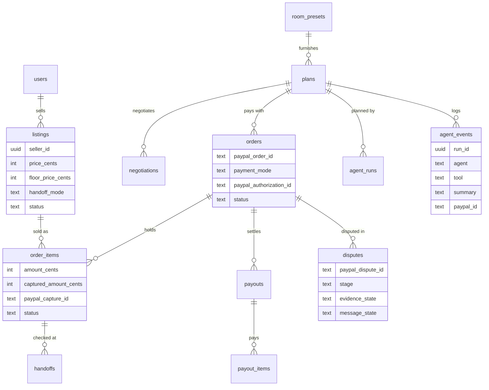

`webhook_events` stores each verified PayPal event once by its event ID, so a redelivered event changes nothing. Money is integer cents everywhere inside the app, and decimal strings appear only at the PayPal boundary.

## Run locally

### Prerequisites

- Node.js 26.13.0 (`nvm use` reads `.nvmrc`) and pnpm 12.18.0 through Corepack 0.36.0, which Node 26 no longer ships
- PostgreSQL 16 or later
- A PayPal developer account with a sandbox REST app, plus Anthropic and Channel3 API keys

### Environment variables

Copy `.env.example` to `.env.local` and fill it in.

| Variable | What it is |
| --- | --- |
| `PAYPAL_CLIENT_ID`, `PAYPAL_CLIENT_SECRET` | The sandbox REST app's credentials |
| `PAYPAL_WEBHOOK_ID` | The webhook registered against the deployed app. Leave it empty locally, and the webhook route answers 503 |
| `ANTHROPIC_API_KEY` | The key for Roomover's Claude calls |
| `CHANNEL3_API_KEY` | The key for Channel3 search |
| `DATABASE_URL` | A Postgres connection string |
| `SESSION_SECRET` | At least 32 random characters, for example from `openssl rand -base64 32` |
| `APP_URL` | `http://127.0.0.1:3000` locally. PayPal's sandbox accepts 127.0.0.1 in return URLs and rejects localhost |
| `RENDER_GIT_COMMIT` | Set by Render on each deploy. Leave it empty locally |
| `PAYPAL_SANDBOX_BUYER_PASSWORD` | Tests only. The judge buyer's password for the live checkout test |
| `PAYPAL_SANDBOX_SELLER_PASSWORD` | Live Sell run only. Seller 1's password for `pnpm sell:run` |
| `ROOMOVER_CLAUDE_FIXTURE`, `ROOMOVER_VERIFIER_FIXTURE`, `ROOMOVER_SELLER_FIXTURE`, `ROOMOVER_CHANNEL3_FIXTURE`, `ROOMOVER_PAYPAL_FIXTURE` | Tests only. Recorded answers that replace the live APIs. Playwright sets them |
| `ROOMOVER_CLAUDE_RECORD` | Local only. Where a live buyer agent run saves its replies |
| `ROOMOVER_E2E_LIVE` | Tests only. Set it to 1 to run checkout and handoff against the real sandbox |

### Sandbox setup

1. In the PayPal developer dashboard, create a sandbox REST app with Payouts, Transaction Search, Customer Disputes, and Log in with PayPal (full name, email, and payer ID). Add the return URL `http://127.0.0.1:3000/api/auth/paypal/callback`.
2. Create a sandbox business account for the platform and personal accounts for a buyer and the five sellers.
3. PayPal sends webhooks only to a public HTTPS URL. Deploy or open a tunnel, then run `pnpm paypal:webhook https://<your-host> --update-env-local` to register the 20 event types and write `PAYPAL_WEBHOOK_ID`.
4. Run `pnpm paypal:smoke` to check the credentials with a real sandbox order.

### Database, run, and test

```bash
nvm use
npm install --global corepack@0.36.0 && corepack enable pnpm
pnpm install
pnpm db:migrate      # applies lib/db/migrations
pnpm db:seed         # Lakeshore University, 5 sellers, 24 listings
pnpm dev             # http://127.0.0.1:3000

pnpm typecheck
pnpm lint
pnpm test            # Vitest unit tests
pnpm test:e2e        # Playwright at 1440 and 390 px on recorded answers
ROOMOVER_E2E_LIVE=1 pnpm test:e2e   # checkout and handoff against the real sandbox
```

## Test accounts for judges

The hosted demo needs no sign up. Furnish runs as the demo student Jordan Ellis, and PayPal approvals use the sandbox accounts below. These are PayPal sandbox accounts that hold only test money, and their passwords are published on purpose.

### Fastest path for judges

1. Open [Furnish](https://roomover.onrender.com/furnish), keep Harbor Hall 214 and "$150, cozy, I study late", and press Plan my room. The room fills in about 30 seconds.
2. Press the PayPal button, sign in as the judge buyer below, and approve.
3. Press Go to handoff, then for each item press Use a sample photo and confirm the amount. An item that also offers Sample with a new tear shows how the verifier and the money policy price new damage.
4. Sellers paid fills with each seller's payout as PayPal reports it.

| Account | Email | Password | What it lets a judge try |
| --- | --- | --- | --- |
| Hosted demo | https://roomover.onrender.com | none | Furnish Harbor Hall 214 and watch the agents negotiate with each seller's agent |
| Judge buyer | `roomover-judge-jin0608@personal.example.com` | `Roomover2026!` | Approve checkout with PayPal or Pay Later, open Handoff with sample photos to pay every seller in the cart, approve a plan an assistant made over MCP, and open a dispute in PayPal's sandbox Resolution Center afterward |
| Seller 1, Ava Lindqvist | `roomover-seller1-jin0608@personal.example.com` | `Roomover2026!` | Log in with PayPal on Sell and list an item from a sample photo, which the buyer agent can then find and buy |

A paid demo order that never reaches a handoff is released within about 3 hours, so a judge who pays and leaves gets the test money back and the listings return to sale.

## Limitations and next steps

- **Marketplace onboarding.** Holding funds between a buyer and a seller in production requires PayPal's marketplace onboarding. The demo runs entirely in the sandbox, collects into the platform's account, and pays sellers out with Payouts.
- **Sellers are paid by email, never by Venmo.** Sandbox userinfo returns no payer ID, so payouts go to the email from Log in with PayPal, and the sandbox refuses Venmo payouts (debug ID `f271928c32152`).
- **Fees and revenue.** The platform absorbs PayPal's capture and payout fees, and each seller receives the full agreed price. A small service fee on each order, or a partnership with a campus that pays for move out reuse, would fund Roomover. Neither is built in the demo.
- **A buyer win does not recover the seller's payout.** In the demo the platform absorbs the refund. In production, Roomover would hold a reserve from each payout through the dispute window or offset the amount against the seller's next payout.
- **A spent Claude budget replays a recorded run.** When the demo's daily Claude calls or an hourly limit would refuse a Furnish run, the room replays the recorded Harbor Hall run, and PayPal and everything after it stay live.
- **MCP sessions live in memory.** The web service runs one instance, so a deploy or a restart ends open sessions and the client starts a new one.
- **Bryntum watermark.** The schedule runs on Bryntum's 45 day trial and shows its "Trial Version" watermark.
- **One campus, partly estimated.** Room presets cover one campus. The double and the single use estimated floor sizes, and the apartment bedroom uses measured ones.
- **No shipping, by design.** Shipping bulky furniture costs more than the items are worth, so every item changes hands on campus. The next step is moving items from room to room through a campus moving or storage partner.
- **A new campus starts with no supply.** The launch path is a partnership with each university's move out reuse program and residence life office.
- **The verifier's result is advisory.** The student confirms every decision at handoff, and disputes go through PayPal.

## License

MIT. See [LICENSE](LICENSE).

The listing, handoff, and Sell sample photos are CC0 public domain works, credited in [`public/seed/listings/CREDITS.md`](public/seed/listings/CREDITS.md), [`public/handoff-samples/CREDITS.md`](public/handoff-samples/CREDITS.md), and [`public/sell-samples/CREDITS.md`](public/sell-samples/CREDITS.md). The studio lighting is the CC0 "Studio Small 08" high dynamic range (HDR) image from Poly Haven, and the Recursive typeface is used under the SIL Open Font License. The PayPal monogram is a trademark of PayPal, Inc., shown only where PayPal processes a payment, under PayPal's brand guidelines.
